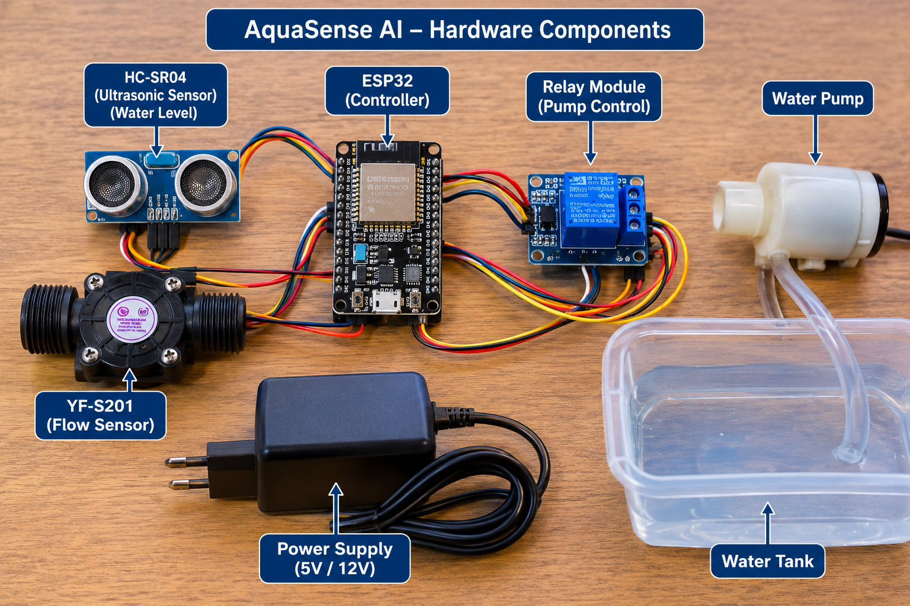
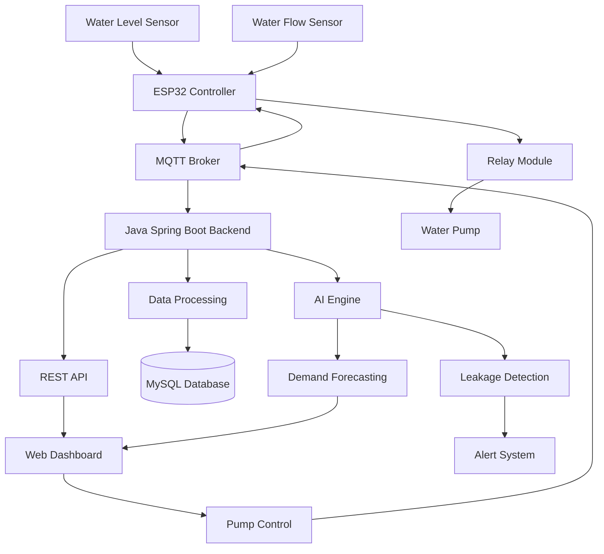

# 💧 AquaSense AI
### AI-Based IoT Water Management System

<p align="center">
  
</p>

<p align="center">
  <b>Smart Water Monitoring • AI Leak Detection • Intelligent Pump Control</b>
</p>

<p align="center">
  
  
  
  
  
  
</p>

---


## Project Report : https://github.com/Ashikur758/AI-Based-IoT-Water-Management-System/blob/main/Ai_based_iot_water.pdf


## 📌 Table of Contents

- [Overview](#-overview)
- [Project Objectives](#-project-objectives)
- [Key Features](#-key-features)
- [Project Screenshots](#-project-screenshots)
- [System Architecture](#-system-architecture)
- [Technology Stack](#-technology-stack)
- [Hardware Components](#-hardware-components)
- [Circuit Connections](#-circuit-connections)
- [Project Structure](#-project-structure)
- [AI Modules](#-ai-modules)
- [API Endpoints](#-api-endpoints)
- [MQTT Communication](#-mqtt-communication)
- [Getting Started](#-getting-started)
- [Future Improvements](#-future-improvements)
- [Contributing](#-contributing)
- [License](#-license)
- [Author](#-author)

---

## 🌍 Overview

**AquaSense AI** is an AI-powered IoT-based water management system designed to monitor water consumption, detect leakage, predict future water demand, and control water pumps intelligently.

The system combines IoT sensors, ESP32, Java Spring Boot, MQTT communication, and Machine Learning to provide an intelligent water monitoring and management solution.

It collects real-time water data from sensors and sends it to a centralized backend server. The backend processes the data, stores historical records, and uses AI-based algorithms to identify abnormal water usage patterns.

Users can monitor their water system and control pumps through a web-based dashboard.

### 🎯 Project Objectives

- Reduce water wastage.
- Monitor water levels in real time.
- Detect abnormal water flow and leakage.
- Predict future water consumption.
- Automate water pump operations.
- Provide remote monitoring and control.
- Improve water resource management.


## ✨ Key Features

| Feature | Description |
|---|---|
| 📊 Real-Time Monitoring | Monitor water level, flow rate, and consumption. |
| 🚰 Smart Pump Control | Automatically control pumps based on water levels. |
| 🔍 AI Leakage Detection | Identify abnormal water flow patterns. |
| 📈 Demand Forecasting | Predict future water requirements. |
| 🧠 Intelligent Scheduling | Optimize pump operation schedules. |
| 🔔 Alert System | Notify users about leakage, overflow, and low water levels. |
| 🔐 Secure Authentication | JWT-based login and role management. |
| 🖥️ Web Dashboard | Visualize sensor data and manage devices remotely. |

---

## 🖼️ Project Screenshots

### 1. Web Dashboard

<p align="center">
  
</p>

<p align="center">
  <i>Real-time water monitoring and intelligent control dashboard.</i>
</p>

### 2. Hardware Implementation

<p align="center">
  
</p>

<p align="center">
  <i>ESP32-based IoT water monitoring hardware.</i>
</p>

### 3. Circuit Diagram

<p align="center">
  
</p>

### 4. System Architecture

<p align="center">
  
</p>

### 5. Leakage Detection Alert

<p align="center">
  
</p>

> **Note:** Upload your actual project images into `docs/images/` using the filenames shown above.

---

## 🏗️ System Architecture

The system consists of four major layers:

1. **IoT Layer:** ESP32 collects sensor data.
2. **Communication Layer:** MQTT transfers data between ESP32 and the server.
3. **Backend & AI Layer:** Spring Boot processes data and executes AI algorithms.
4. **Presentation Layer:** Web dashboard displays information and provides control.



---

## 🛠️ Technology Stack

### Embedded / IoT

- ESP32 DevKit
- Arduino IDE / PlatformIO
- Embedded C/C++
- Ultrasonic Sensor
- Water Flow Sensor
- MQTT Communication

### Backend Development

- Java 17+
- Spring Boot
- Spring Web
- Spring Data JPA
- Spring Security
- Spring WebSocket
- Eclipse Paho MQTT Client

### AI & Machine Learning

- Statistical Anomaly Detection
- Z-Score Algorithm
- Moving Average
- Linear Regression
- Polynomial Regression
- Weka / Smile / Tribuo

### Frontend

- HTML5
- CSS3
- JavaScript
- Bootstrap
- Chart.js
- Thymeleaf / React

### Database & Communication

- MySQL / PostgreSQL
- MQTT
- Mosquitto Broker
- HTTP REST API

---

## 🔧 Hardware Components

| Component | Purpose |
|---|---|
| ESP32 DevKit | Main microcontroller |
| HC-SR04 Ultrasonic Sensor | Measures tank water level |
| YF-S201 Flow Sensor | Measures water flow |
| Relay Module | Controls water pump |
| Water Pump | Pumps water into the tank |
| Power Supply | Provides electrical power |
| Connecting Wires | Hardware connections |
| TDS Sensor (Optional) | Measures water quality |
| pH Sensor (Optional) | Monitors water acidity |

---

## 🔌 Circuit Connections

The following pin configuration is suggested for the ESP32.

| Device | Pin | ESP32 GPIO |
|---|---|---|
| HC-SR04 | TRIG | GPIO 5 |
| HC-SR04 | ECHO | GPIO 18 |
| YF-S201 | Signal | GPIO 27 |
| Relay Module | IN | GPIO 26 |
| All Sensors | GND | GND |
| Sensors | VCC | Appropriate supply |

⚠️ **Important:** HC-SR04 ECHO produces a 5V signal. Use a voltage divider before connecting it to the ESP32 GPIO. Check the voltage requirements of all modules before powering them.

---

## 📁 Project Structure

```text
AquaSense-AI/
│
├── firmware/
│   ├── src/
│   │   └── main.ino
│   └── README.md
│
├── backend/
│   └── src/main/java/com/aquasense/
│       ├── controller/
│       ├── service/
│       ├── repository/
│       ├── model/
│       ├── mqtt/
│       ├── ai/
│       ├── security/
│       └── AquaSenseApplication.java
│
├── frontend/
│   ├── css/
│   ├── js/
│   └── index.html
│
├── docs/
│   └── images/
│       ├── banner.png
│       ├── dashboard.png
│       ├── hardware-setup.jpg
│       ├── circuit-diagram.png
│       ├── system-architecture.png
│       └── leakage-alert.png
│
├── .gitignore
├── LICENSE
└── README.md
```

---

## 🧠 AI Modules

### 1. AI-Based Leakage Detection

The leakage detection module analyzes water flow patterns to identify abnormal consumption.

**Working Process:**

- Collect real-time flow sensor readings.
- Calculate rolling mean and standard deviation.
- Apply Z-Score anomaly detection.
- Identify unusual water consumption.
- Generate leakage alerts.

Example:

```java
double zScore = (currentFlow - mean) / standardDeviation;

if (Math.abs(zScore) > 3.0) {
    System.out.println("Abnormal water flow detected!");
}
```

### 2. Water Demand Forecasting

The forecasting module predicts future water consumption using historical data.

**Working Process:**

- Collect historical water consumption.
- Analyze daily and hourly usage.
- Apply regression algorithms.
- Predict upcoming water demand.
- Optimize water storage and pump scheduling.

### 3. Intelligent Pump Control

The smart pump control module considers:

- Current tank water level.
- Predicted water demand.
- Historical consumption.
- Pump operating status.

It automatically controls the pump to reduce unnecessary energy consumption and water wastage.

> AI predictions are decision-support inputs. Independent safety limits and sensor checks should always protect against overflow and dry running.

---

## 🌐 REST API Endpoints

| Method | Endpoint | Description |
|---|---|---|
| POST | `/api/auth/register` | Register a new user |
| POST | `/api/auth/login` | User authentication |
| POST | `/api/devices` | Register an IoT device |
| GET | `/api/devices` | Get all devices |
| POST | `/api/sensor-data` | Receive sensor readings |
| GET | `/api/devices/{id}/latest` | Get latest sensor data |
| GET | `/api/devices/{id}/history` | Get historical data |
| POST | `/api/devices/{id}/pump` | Control water pump |
| GET | `/api/devices/{id}/forecast` | Get AI demand forecast |
| GET | `/api/alerts` | Get system alerts |

### Sample Sensor Data (JSON)

```json
{
  "deviceId": "ESP32-001",
  "waterLevelPercent": 72.5,
  "flowRateLpm": 3.4,
  "totalLiters": 1250.8,
  "pumpStatus": false,
  "timestamp": "2026-01-15T10:30:00Z"
}
```

---

## 📡 MQTT Communication

MQTT is used for communication between ESP32 and the Spring Boot backend.

| MQTT Topic | Direction | Purpose |
|---|---|---|
| `aquasense/{deviceId}/data` | ESP32 → Server | Sensor readings |
| `aquasense/{deviceId}/command` | Server → ESP32 | Pump control |
| `aquasense/{deviceId}/status` | ESP32 → Server | Device status |

### Example Pump Command

```json
{
  "command": "PUMP_ON"
}
```

---

## 🚀 Getting Started

### Prerequisites

Install the following software:

- [Java JDK 17+](https://adoptium.net/)
- [IntelliJ IDEA](https://www.jetbrains.com/idea/)
- [Apache Maven](https://maven.apache.org/)
- [MySQL](https://dev.mysql.com/downloads/)
- [Arduino IDE](https://www.arduino.cc/en/software)
- [Mosquitto MQTT Broker](https://mosquitto.org/)
- [Git](https://git-scm.com/)

### 1. Clone the Repository

```bash
git clone https://github.com/Ashikur758/AquaSense-AI.git

cd AquaSense-AI
```

### 2. Create the Database

```sql
CREATE DATABASE aquasense;
```

### 3. Configure Backend

Open:

`backend/src/main/resources/application.properties`

Add the following configuration:

```properties
spring.datasource.url=jdbc:mysql://localhost:3306/aquasense
spring.datasource.username=your_username
spring.datasource.password=your_password

spring.jpa.hibernate.ddl-auto=update

mqtt.broker.url=tcp://localhost:1883

server.port=8080
```

Configure your JWT secret securely using environment variables rather than committing secrets to GitHub.

### 4. Run Spring Boot Backend

```bash
cd backend

./mvnw spring-boot:run
```

On Windows:

```bash
mvnw.cmd spring-boot:run
```

Backend URL:

`http://localhost:8080`

### 5. Configure ESP32

1. Open `firmware/src/main.ino`.
2. Configure Wi-Fi credentials.
3. Configure MQTT broker address.
4. Connect the sensors according to the pin configuration.
5. Select ESP32 Dev Module in Arduino IDE.
6. Upload the firmware.

### 6. Open Web Dashboard

Visit:

`http://localhost:8080`

Login to access the AquaSense AI dashboard.

---

## 🗺️ Future Improvements

- [ ] Complete project architecture.
- [ ] ESP32 water-level monitoring.
- [ ] Water flow monitoring.
- [ ] ESP32 to Spring Boot communication.
- [ ] MQTT integration.
- [ ] MySQL database integration.
- [ ] Automatic pump control.
- [ ] Real-time web dashboard.
- [ ] AI-based leakage detection.
- [ ] Water demand forecasting.
- [ ] Smart pump scheduling.
- [ ] Email and SMS notifications.
- [ ] Water quality monitoring.
- [ ] Mobile application.
- [ ] Cloud deployment using Docker.

---

## 🤝 Contributing

Contributions are welcome!

If you want to contribute:

1. Fork this repository.
2. Create a new branch.

```bash
git checkout -b feature/your-feature
```

3. Commit your changes.

```bash
git commit -m "Add new feature"
```

4. Push your branch.

```bash
git push origin feature/your-feature
```

5. Open a Pull Request.

---

## 📄 License

This project is licensed under the MIT License.

See the [LICENSE](LICENSE) file for more information.

---

## 👨‍💻 Author

**Md. Ashikur Rahman Ashik**

Department of Information and Communication Technology (ICT)  
Mawlana Bhashani Science and Technology University (MBSTU)

- GitHub: [@Ashikur758](https://github.com/Ashikur758)
- Project Repository: [AquaSense AI](https://github.com/Ashikur758/AquaSense-AI)

---

<p align="center">
  <b>💧 AquaSense AI – Smart Technology for a Sustainable Water Future.</b>
</p>

<p align="center">
  ⭐ If you find this project useful, please give this repository a star!
</p>
